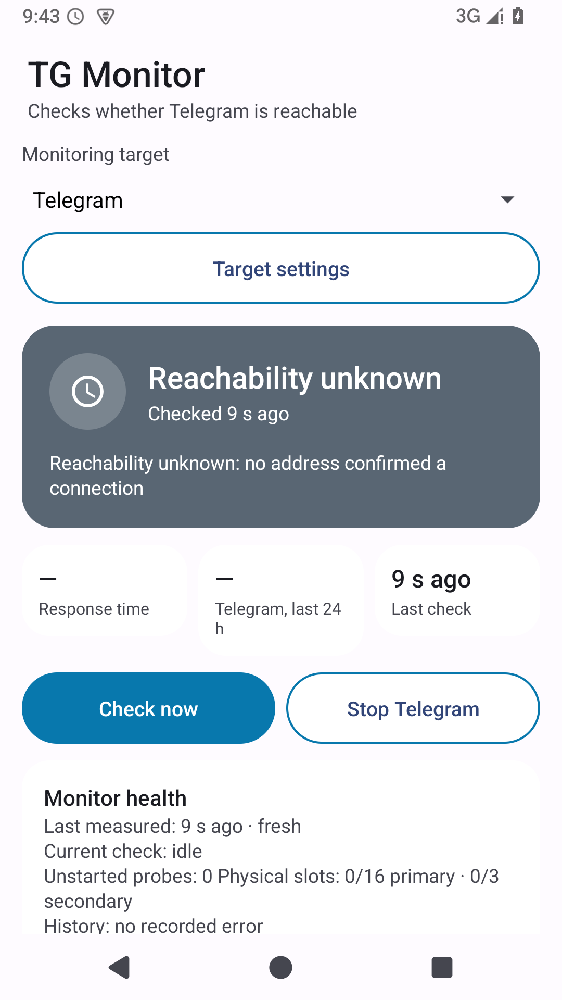
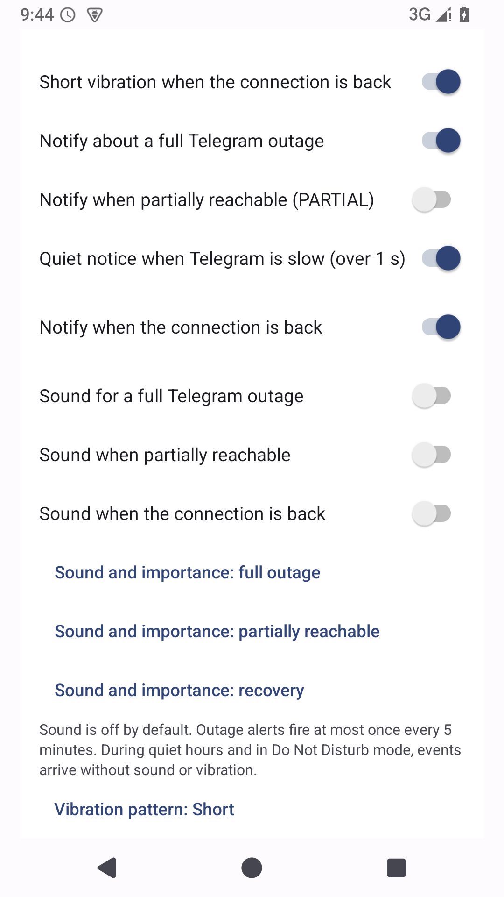

# TG Монитор

> **In English:** TgWatch is an Android app (8.0+) that checks locally whether Telegram is reachable,
> using MTProto with a random nonce plus Telegram's web resources. It tells you whether Telegram is
> down, partly down, or whether your own internet is the problem. No Telegram account, phone number
> or access to messages is needed. Data stays on the phone unless you separately enable a webhook
> or consent to send crash reports to your own HTTPS collector.
> Optional targets: Matrix, WhatsApp Web and your own HTTPS services.
> [English overview](docs/README.en.md) · [Download APK](https://github.com/qlolp/TgWatch/releases/latest)

Android-приложение для локального наблюдения за доступностью Telegram. Android 8.0+.
Аккаунт Telegram, номер телефона и доступ к переписке не нужны. Приложение не отправляет сообщения.
Отчёты о сбоях выключены по умолчанию: их можно отправлять только на свой HTTPS-сборщик после отдельного согласия.

Можно явно включить независимые цели Matrix, WhatsApp (веб) и свой HTTPS:
у каждой свои история, интервалы и уведомления. Telegram остаётся целью по умолчанию.
[Настройка целей, CSV v3 и ограничения](docs/multiservice.md).

## Что показывает

Выпуск [1.25.0](docs/releases/1.25.0.md) добавил расширенные HTTPS health-проверки,
до пяти webhook-получателей, ntfy и MQTT/TLS, отправку crash report на свой collector
после отдельного согласия и встроенный Python в Mac-сборку. Android 8.0+ и targetSdk 36 сохранены;
сборка использует Android SDK 37. В 1.24.0 появились до пяти своих HTTPS-целей,
общий обзор и ожидания публичного ответа, переживающие перезагрузку
([заметки 1.24.0](docs/releases/1.24.0.md)).
В 1.23.0 появились региональная история, сравнения A/B и объяснения результатов
([заметки 1.23.0](docs/releases/1.23.0.md), [как пользоваться](docs/regional-services.md)).
Есть [нативное меню Mac и локальная сборка](docs/macos.md).
Актуальный опубликованный выпуск и
подписанные APK находятся на [GitHub Releases](https://github.com/qlolp/TgWatch/releases/latest).
Сборка из ветки разработки сама по себе не означает публикацию релиза.

- **Telegram отвечает:** получены ответ MTProto с совпавшим случайным nonce и HTTP-ответ одного из веб-ресурсов Telegram.
- **Частично доступен:** ответил только MTProto или только веб-ресурс.
- **Telegram недоступен:** контрольный сайт ответил, а Telegram не подтвердил доступность.
- **Нет сети:** отсутствует активное подключение либо Wi-Fi требует входа.
- **Доступность не определена:** ни один адрес не подтвердил связь. Таймаут контрольных сайтов не доказывает отсутствие интернета.
- **Мониторинг задерживается:** результат устарел; открытый процесс сам по себе не считается работающим мониторингом.

MTProto-проверка — только начальный обмен `req_pq_multi` / `resPQ`, без создания аккаунтной сессии.
Принимается только полный структурно корректный `resPQ`: nonce, заголовок, server message id,
TL-поле `pq`, выравнивание и вектор fingerprints проверяются в ограниченной рамке до 4096 байт.
Она подтверждает ответ протокола, **не доставку сообщений и не криптографическую аутентификацию сервера**.
Прокси, заданный внутри самого Telegram, не используется. Системный VPN учитывается как часть активной сети.

В диагностике видны Wi-Fi / мобильная сеть / VPN, время проверки, каждый проверенный адрес,
HTTP-код, DNS/TLS/таймаут и время ответа. Все запросы привязаны к выбранной Android Network;
при её смене результат отбрасывается как неопределённый и запускается новая проверка.

## Установка

[Скачать последний APK](https://github.com/qlolp/TgWatch/releases/latest/download/TgWatch.apk)
(Android 8.0+). Часы Wear OS 3+ — отдельный файл `TgWatch-wear.apk` на той же странице выпусков.
Разрешите уведомления и работу в фоне, иначе Android может откладывать проверки.
Как публикуются выпуски и как проверить подпись — в разделе [выпуски и разработка](docs/release-and-development.md).

## Профили проверок

| Профиль | Экран включён | Экран выключен | Подтверждённый сбой |
|---|---:|---:|---:|
| Экономичный | 60 с | 300 с | 60 с |
| Обычный | 30 с | 120 с | 30 с |
| Частый | 15 с | 60 с | 10 с |

Можно задать свой интервал. Android Doze и ограничения производителя могут откладывать
проверки, поэтому приложение показывает возраст результата, а не обещает жёсткий интервал.
Подробности про батарею, оповещения и тихие часы — в [руководстве](docs/usage.md).

## Документация

[Полный указатель документации](docs/README.md) · [Текущее состояние и приоритеты](docs/development-roadmap.md)

| Тема | Где читать |
|---|---|
| Батарея, оповещения, история, CSV, графики | [Руководство](docs/usage.md) |
| Резервная копия и восстановление | [Руководство](docs/usage.md#резервная-копия-и-восстановление), [форматы](docs/backup.md) |
| Matrix, WhatsApp, свой HTTPS, вебхук | [Цели](docs/multiservice.md), [автоматизация](docs/automation.md) |
| Диагностика | [Поля отчёта](docs/diagnostics.md) |
| Виджеты, задержки, поделиться статусом | [Руководство](docs/usage.md#задержки-виджеты-и-карточка-статуса) |
| Wear OS | [Сборка и проверка](docs/wear.md), [руководство](docs/usage.md#wear-os) |
| Выпуски, подпись, проверки, сборка | [Выпуски и разработка](docs/release-and-development.md), [CONTRIBUTING](CONTRIBUTING.md) |
| Mac | [Сборка, встроенный Python и подпись](docs/macos.md) |
| Физические устройства и батарея | [Протокол измерений](docs/power-validation.md) |
| F-Droid | [Инструкция](docs/fdroid.md) |
| Следующие шаги и границы готовности | [Решения по развитию](docs/development-roadmap.md) |
| Порядок в репозитории и архив веток | [Сопровождение](docs/maintenance/README.md) |
| Архитектура | [Карта архитектуры](docs/superpowers/architecture.md) |
| История версий | [CHANGELOG](CHANGELOG.md) |
| Аудиты кода | [2026-10-11](docs/review/improvements-2026-10-11.md), [2026-10-12](docs/review/improvements-2026-10-12.md) |

## Скриншоты

Основной экран и дополнительные настройки на эмуляторе Android 15.

| Основной экран | Дополнительные настройки |
|---|---|
|  |  |

Лицензия: [MIT](LICENSE).
