# Архитектура TgWatch

Android 8.0+; native Views и одна foreground-служба телефона. Чистые Kotlin policies и codecs отделены от Android-хранилища, Network/SAF и UI. Общий `:probe-core` используют телефон и самостоятельное Wear OS-приложение. Нативное macOS-приложение и CLI выполняют проверки на своём подключении и не синхронизируют историю телефона.

Карта ниже описывает основные потоки данных Android-приложения. Наличие пути не заменяет отчёт о его проверке.

```mermaid
flowchart TD
    UI["MainActivity · цели, история, SAF preview"]
    REGIONAL_UI["RegionalServicesActivity · профили, A/B, объяснения"]
    SERVICE["MonitorService · foreground lifecycle"]
    TARGETS["TargetRepository / TargetRunner · независимые цели"]
    SCHEDULE["CheckSchedule / TargetSchedule / OfflineBackoff"]
    NETWORK["Android Network adapter"]
    PROBE["NetworkProbe / :probe-core · shared deadline"]
    HTTP["HTTPS · Telegram, controls и другие цели"]
    MT["MtProto · bounded req_pq_multi / resPQ"]
    HISTORY["TargetHistories / HistoryStorage · 7/30/90 дней"]
    ROLLUP["HistoryRollup · raw + минутные/пятиминутные агрегаты"]
    TIMELINE["Timeline · clock epochs, gaps, counts, MTTR"]
    PREPARE["HistoryPreparationCache / HistoryDisplay"]
    LOADER["MainHistoryUi / LatestRequestLoader · background work"]
    INCIDENTS["IncidentActivity / OutageEpisodes · observed boundaries"]
    EXTRAS["ExtraProbeCoordinator · isolated late diagnostics"]
    REGIONAL["RegionalMonitor / RegionalRepository · public-site evidence"]
    REGJOURNAL["RegionalJournal · до 1000 событий за 7 дней"]
    REGWATCH["RegionalChangeWatch · durable intent, fresh evidence"]
    MUTE["AlertMute · elapsed time + boot identity"]
    WEBHOOK["WebhookDelivery · generation + 10s result deadline"]
    PREFS["Prefs / TargetPreferences / RegionalPreferences"]
    SUCCESS["LastSuccessStore / LastSuccessPolicy · published OK only"]
    PRESENT["StatusWidget / EventNotifications / RegionalNotifications"]
    LOG["EventLog / CrashJournal"]
    FILE["SAF document · encrypted backup or plaintext CSV"]
    SNAP["TargetBackupCodec / BackupCodec · strict whitelist + bounds"]
    CRYPTO["PortableBackupCodec · container v3 + legacy readers + AES-GCM"]
    LEGACY["TGWB v1/v2 · local TGWBKUP1"]
    CSV["TargetCsv / CsvImport · named histories"]
    RESTORE["TargetRestore / RestoreTransaction · confirmed replace"]
    START["Application startup · pending replay before components"]
    AUTO["AutomationReceiver · opt-in capability token"]
    CREDENTIALS["Credential-protected private settings"]
    DIAG["LocalDiagnostics · bounded redacted export"]
    SUMMARY["DailySummaryReceiver · local-time opt-in summary"]

    UI --> SERVICE
    UI --> CREDENTIALS
    UI --> DIAG
    UI --> PREFS
    SERVICE --> TARGETS
    SERVICE --> SCHEDULE
    SERVICE --> NETWORK
    SERVICE --> EXTRAS
    SERVICE --> WEBHOOK
    SERVICE --> SUCCESS
    SERVICE --> LOG
    SERVICE --> PRESENT
    TARGETS --> SCHEDULE
    TARGETS --> NETWORK
    TARGETS --> HISTORY
    TARGETS --> WEBHOOK
    TARGETS --> PRESENT
    SCHEDULE --> SERVICE
    NETWORK --> PROBE
    PROBE --> HTTP
    PROBE --> MT
    PROBE --> TARGETS
    HISTORY --> ROLLUP
    HISTORY --> TIMELINE
    HISTORY --> SUMMARY
    ROLLUP --> PREPARE
    TIMELINE --> LOADER
    PREPARE --> LOADER
    LOADER --> UI
    PREPARE --> INCIDENTS
    EXTRAS --> PROBE
    EXTRAS --> UI
    SUMMARY --> PRESENT
    SUCCESS --> PRESENT
    UI --> MUTE
    MUTE --> PRESENT
    WEBHOOK --> CREDENTIALS
    PREFS --> SERVICE

    REGIONAL_UI --> REGIONAL
    REGIONAL --> NETWORK
    REGIONAL --> REGJOURNAL
    REGIONAL --> REGWATCH
    REGIONAL --> PRESENT
    REGWATCH --> PREFS
    REGJOURNAL --> REGIONAL_UI

    UI --> FILE
    HISTORY --> SNAP
    PREFS --> SNAP
    LOG --> SNAP
    SNAP --> CRYPTO
    CRYPTO --> FILE
    FILE --> LEGACY
    LEGACY --> CRYPTO
    FILE --> CRYPTO
    CRYPTO --> SNAP
    FILE --> CSV
    SNAP --> RESTORE
    CSV --> RESTORE
    START --> RESTORE
    RESTORE --> HISTORY
    RESTORE --> PREFS
    RESTORE --> LOG
    RESTORE --> SUCCESS
    AUTO --> CREDENTIALS
    AUTO --> SERVICE
    DIAG --> FILE
```

## Границы поведения

- **MTProto:** unauthenticated greeting без аккаунта и RPC. Парсер проверяет весь TL `resPQ` и canonical abridged frame ≤4096 байт. Ответ с nonce подтверждает протокол, но не подлинность сервера или доставку сообщений. Telegram сохраняет общий бюджет 6 с и дополнительный бюджет controls; отмена закрывает транспорт.
- **Независимые цели:** Telegram, Matrix, WhatsApp Web и до пяти Custom HTTPS имеют собственные настройки, истории, endpoint revisions и оповещения. Необязательные HTTPS-слоты скрыты до явного добавления; удаление стирает их приватные настройки и историю. Одна служба ограничивает физическую работу шестнадцатью primary и тремя secondary workers. EXTRA остаётся информационной диагностикой и не включает самостоятельную цель автоматически. Общего cross-service процента доступности нет.
- **Региональные профили:** проверяют только публичные страницы выбранных сервисов. Для регионального предупреждения нужны два явных ответа на одном соединении с интервалом не менее 15 секунд. A/B-сравнения и пользовательские отметки не подменяют автоматическую классификацию. Журнал ограничен 1000 событиями за семь дней и не входит в переносимые бэкапы.
- **Одноразовое ожидание:** сохраняется только намерение и оставшийся срок, не положительные свидетельства. После перезагрузки запрос восстанавливается при неизменном включённом профиле, но требует новой пары свежих ответов. Перевод часов назад, истечение срока, восстановление бэкапа и отключение профиля отменяют запрос.
- **Паузы и webhook:** обычная пауза оповещений считает elapsed time в пределах одной загрузки устройства; перезагрузка завершает её. Webhook ограничивает ожидание результата 10 секундами, но зависший транспорт занимает физический слот до завершения. JSON v1 событийный, JSON v2 heartbeat — отдельный opt-in формат.
- **История:** выбранное окно составляет 7, 30 или 90 дней; неделя хранит сырые проверки, более длинные окна добавляют минутные/пятиминутные агрегаты. Gaps остаются UNKNOWN time; clock rollback создаёт новую эпоху. MTTR учитывает только полностью наблюдённый TG_DOWN, закрытый свежим OK в текущем окне. PARTIAL может продолжать такой эпизод; gaps, UNKNOWN/NO_NETWORK и clipping его исключают.
- **Backup:** новый экспорт всех целей использует TGWB container v3 и сохраняет `history_retention`. Обычный набор записывается как JSON `formatVersion=4`; при добавленных HTTPS 2–5 используется `formatVersion=5`, который читают версии 1.24+. JSON v3 и прежние поддерживаемые форматы читаются. Отдельный Telegram-only экспорт использует совместимый v2. Поддерживаются чтение опубликованного TGWB v1 и локального TGWBKUP1. Пароль экспорта — 12–256 символов; AES-256-GCM аутентифицирует header и ciphertext. Приватные адреса, критерии health-check, токены, диагностический last OK, состояние службы, cooldowns и Android permissions не экспортируются.
- **Restore:** после preview и подтверждения заменяет данные и оставляет все цели остановленными. Pending journal replay идемпотентно завершает прерванную замену до работы компонентов; это серия durable записей, а не обещание одной файловой транзакции Android. Неверный пароль и malformed input не создают transaction и не останавливают действующий monitoring.
- **CSV:** v3 содержит target id и публичные endpoint revisions, а импорт заменяет только явно названные истории. Legacy CSV относится к Telegram. UNKNOWN-строки положительной длительности опускаются, поскольку формат не отличает реальные UNKNOWN checks от generated gaps; zero-width metadata сохраняет clock epoch и endpoint identity.
- **Quiet hours и last success:** quiet hours — local minute-of-day с legacy hour fallback; last success — сохранённый опубликованный OK, независимый от свежести текущего состояния.
- **Automation:** явный opt-in и 256-bit bearer token; только snapshot статуса и ручной запрос уже работающей службе. Нет включения мониторинга, обхода pending restore или автоматического запуска службы. Секреты находятся отдельно от backup и device-protected settings.
- **Diagnostics:** локальный ограниченный JSON через SAF, только фиксированные поля и агрегаты. Нет raw history/log, автоматической отправки или credential export. Scheduling counters измеряют задержку по monotonic clock; состояние device idle не доказывает причину задержки.

## Выпуск

```mermaid
flowchart LR
    INPUT["main push / PR / version tag / manual workflow"] --> CHECKS["build + unit + detekt + lint + Android scenarios"]
    CHECKS --> INVENTORY["resolved releaseRuntimeClasspath"]
    INVENTORY --> BOM["CycloneDX 1.6 · purl / version / SHA-256"]
    BOM --> SCAN["Trivy HIGH / CRITICAL gate"]
    CHECKS --> OSV["resolved runtime + tests · OSV audit"]
    OSV --> ARTIFACT
    SCAN --> ARTIFACT["this run's SBOM + Trivy + OSV evidence"]
    ARTIFACT --> POLICY_INPUT["matching SemVer + main reachability + monotonic code"]
    POLICY_INPUT --> SIGN["existing signing identity + upgrade gates"]
    SIGN --> POLICY["serialized release-policy · immutable tag/assets"]
    POLICY --> RELEASE["APK + hash + SBOM + Trivy / OSV reports"]
    POLICY --> LATEST["latest only for higher versionCode"]
```

Оба audits должны завершиться успешно; недоступность не превращается в чистый результат. Trivy проверяет HIGH/CRITICAL с runtime package coverage, OSV — точные runtime/test Maven versions и неотозванные записи. SBOM отражает разрешённые JAR/AAR runtime dependencies, а не Android platform или test libraries. Публикации отделены от отменяемых checks; signing helper принимает только существующий private key с expected-certificate проверкой и не генерирует новый. Production continuity проверяется в CI, development-key upgrade этого не доказывает.

Текущие команды и ограничения проверок: [CONTRIBUTING](../../CONTRIBUTING.md). Форматы данных: [backup](../backup.md) и [multiservice](../multiservice.md). Исторические спецификации сохранены в этом каталоге и не заменяют текущие руководства.
