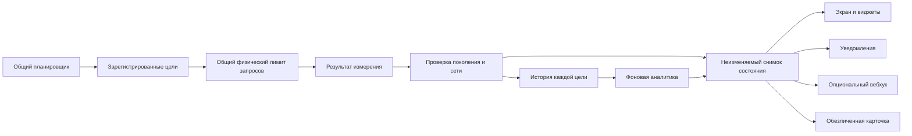

# Развитие TgWatch: границы и порядок работ

Статус: проект спецификации для согласования; реализация ещё не начата.
Основание: пользователь согласовал подготовку спецификации 17 октября 2026 года.
База: `main` на `02c435c` (1.18.0). PR #51 на `334831a` рассматривается отдельно.

## Цель

Сохранить локальный монитор доступности и расширить его до нескольких независимых
целей, с понятной надёжностью измерений, аналитикой задержек, интеграциями и удобными
носителями. Пользователь попросил реализовать все предложения последнего аудита и
добавил мультисервис, дистрибуцию, задержки, Wear OS, виджеты и обмен статусом.

Успех — работающие пользовательские сценарии с проверенной миграцией, а не наличие
новых классов. Материалы для F-Droid и готовая сборка не означают принятие в каталог.

## Выбранное устройство системы

Рекомендуется один Android foreground-сервис, реестр целей и независимые состояния,
истории и правила уведомлений. Общий координатор ограничивает физические пробы
на весь процесс; дополнительные цели не задерживают публикацию Telegram.

Рассмотренные альтернативы:

| Подход | Польза | Цена |
| --- | --- | --- |
| Один сервис, независимые цели | Сохраняет фоновые гарантии и общий бюджет | Нужны явные идентификаторы и миграция |
| Отдельный Android Service на цель | Простая локальная изоляция | Несколько жизненных циклов, будильников и конкурирующих ресурсов |
| Полная миграция на Room/Compose/DI сразу | Новые готовые абстракции | Большая миграция без необходимости для текущих функций |

Первый подход является предлагаемым решением. Второй и третий не входят в эти этапы.

## Общие ограничения

- Телефон: Android API 26+, compile/target API 35; Kotlin и существующий Views UI.
- Один foreground-сервис; нет сервера автора, учётной записи или фоновой телеметрии.
- Общий бюджет проб — 19 физических операций; вебхук отдельно занимает максимум
  одну операцию. Это максимум 20 сетевых операций этих подсистем на процесс.
- Дополнительные цели и внешние интеграции выключены по умолчанию.
- Недоступность измерения, отсутствие сети и измеренный сбой сервиса различаются.
- Время ожидания и свежесть в текущей сессии основаны на монотонных часах.
- Сохраняются clock epochs, UNKNOWN-пробелы и предел прогнозируемого покрытия.
- URL интеграций, токены и заголовки остаются в credential-protected хранилище,
  вне Direct Boot, бэкапов, логов, диагностики и карточек обмена.
- Пользовательские URL проб также исключаются из новых внешних отчётов и формата
  бэкапа v3. Импорт старых бэкапов с публичным EXTRA URL остаётся поддержан.
- Нет ослабления TLS, проверки подписи, checksum или правил публикации.
- `claude/project-thread-s0ejzl` не изменяется, не удаляется и не используется как
  рабочая ветка. Из PR #51 переносятся нужные изменения в отдельную ветку либо
  используется обновлённый main, если PR уже принят; исходный PR не переписывается.
- Существующие API v1, виджет Telegram и чтение бэкапов v1/v2 сохраняются.
- Новые пользовательские строки добавляются на русском и английском.

## Независимые проекты

| Этап | Результат и спецификация | Зависимость |
| --- | --- | --- |
| A | [Надёжность измерений, истории и жизненного цикла](2026-10-17-reliability-design.md) | Актуальный main; адаптер для PR #51 |
| B | [Покрытие, здоровье мониторинга, JSON-вебхук и Home Assistant](2026-10-17-insights-webhook-design.md) | A |
| C | [Независимые цели и безопасная миграция](2026-10-17-multiservice-design.md) | A, B |
| D | [Перцентили, тренды и пороговые оповещения](2026-10-17-latency-design.md) | C |
| E | [Виджеты и карточка статуса](2026-10-17-surfaces-design.md) | C, D |
| F | [Самостоятельный клиент Wear OS](2026-10-17-wear-design.md) | A; общий probe-core выделяется на этом этапе |
| G | [Дистрибуция и материалы репозитория](2026-10-17-distribution-design.md) | Можно готовить после A; скриншоты после E |

Каждый этап получает собственный план реализации и проверки. Это позволяет выпускать
готовые изменения последовательно и не связывать исправление ложных сбоев с Wear OS.
G не должен ждать окончания остальных проектов ради обновления описания репозитория.

## Поток данных

Диск и аналитика не выполняются из главного потока. Снимок содержит revision,
времена проверки, статус измерения и состояние сохранения; компоненты не смешивают
результаты разных проверок, поколений настроек или сетей.

## Решения, требующие внимания при согласовании

1. В первой версии одновременно доступны четыре цели: Telegram, один Matrix
   homeserver, веб-инфраструктура WhatsApp и один пользовательский HTTPS endpoint.
2. Matrix и WhatsApp не проверяют доставку сообщений, звонки или авторизованный аккаунт.
3. По старой истории можно получить распределение лучшей MTProto-задержки каждой
   проверки. `LatencyTotal` не содержит распределения или измерений по DC; такие
   измерения собираются только после обновления.
4. Wear OS предлагается самостоятельным измерителем **с часов**. Он не показывает
   измерения телефона как свои. Синхронизация с телефоном потребует отдельного
   протокола; proprietary SDK в телефонную F-Droid-сборку не добавляется.
5. История новых целей увеличивает общий объём. Формат бэкапа v3 ограничен 16 MiB,
   чтение v1/v2 — прежними 8 MiB; миграция подробно определена в C.
6. При оптимизации истории логическое окно остаётся семь дней. Просроченные строки
   могут оставаться в физическом журнале до очередной компактизации, максимум шесть
   часов; в статистику, экспорт и бэкап они не входят.

## Завершение и выпуск

Для каждого этапа: релевантные JVM-регрессии, detekt, Android lint, сборка APK и
Android lifecycle/UI-проверки затронутых сценариев. Для C обязательны crash/restart
тесты миграции и restore. Для F нужны отдельные сборка и проверка на Wear OS.

Тесты на настоящем Android, пропущенные проверки и изолированные JVM-пробы
перечисляются отдельно. Версия выбирается по актуальному main и релизам на момент
интеграции. Существующие теги и ассеты не перезаписываются, production signing key
не меняется. Выпуск готов только после проверки APK, подписи и всех ассетов.

Следующий шаг: согласование этих спецификаций, затем планы реализации по этапам.
