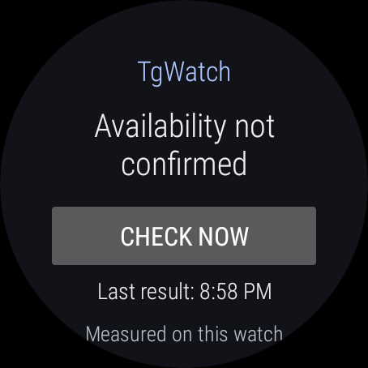
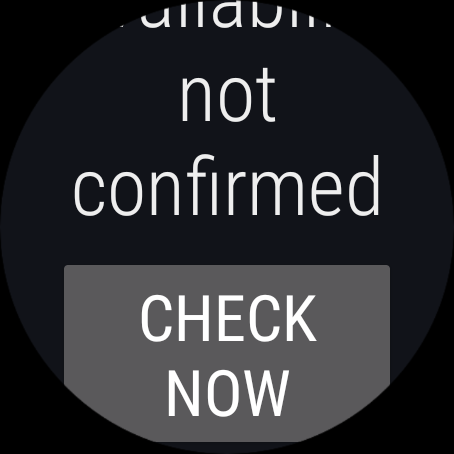

# Standalone Wear OS

The `:wear` module is `ru.tgwatch.wear`, for Wear OS 3+/API30. It measures the
watch's own active Android Network. It does not synchronize a phone's status,
history or credentials, and does not need Google Play Services or Data Layer.
The installed runtime graph is included in its separate release SBOM.

Open TgWatch and tap **Check now**. One web endpoint and three rotating embedded
MTProto DCs share an eight-second result deadline and four physical process-wide
transport permits. Cancellation, activity replacement and timeouts do not free
permits until the transport actually exits. A failed subset says unconfirmed;
it cannot establish a global Telegram outage. MTProto confirms an unauthenticated
greeting, not message delivery or the server's cryptographic identity.

The cache survives process death, but expires after three minutes. Persisted
elapsed time is invalidated on reboot. Tile and short/long-text complications read
this cache only, including in ambient mode. Tapping opens a visible manual check;
the exported activity rejects forged check extras. The complication's tap uses
an immutable PendingIntent. The API30-compatible tile uses an explicit activity
launch with an installation-private capability. A tile rendered during cold cache
loading opens the manual screen without automatically checking.

There are no foreground services, exact alarms or periodic network checks in this
module. System requests to refresh the tile/complication never trigger a probe.
The tile has an explicit stale timeline frame; a fresh complication has a bounded
validity interval so it cannot remain fresh indefinitely without an update.

Build with the repository's JDK17/SDK35 toolchain:

```sh
bash ./gradlew :probe-core:test :wear:testDebugUnitTest :wear:lintDebug :wear:assembleDebug :wear:assembleRelease :wear:generateReleaseSbom --no-daemon
```

On a dedicated Wear OS3+ emulator/device (not a phone):

```sh
ANDROID_SERIAL=emulator-5558 bash scripts/wear-smoke.sh
```

The smoke executes native manual/cache/tile/complication tests, rejects skipped or
zero-test runs, saves a screenshot and checks application crash logs. Provider
callback tests do not certify every third-party watch face or vendor launcher;
their rendering and TalkBack behavior should also be checked on the actual watch.

The unified GitHub release contains `TgWatch-wear.apk`, SHA-256, resolved dependency
inventory, OSV report, CycloneDX SBOM and Trivy report alongside the six phone files.
Both apps use the same source version and existing production signing identity.
Local debug APKs have a different certificate. The F-Droid candidate covers only
the phone package; Wear catalog acceptance is not implied.

## Device screenshots

Actual Wear OS3/API30 emulator captures from1.19.0: the normal screen, and the
check action after scrolling at200% font scale. Status remains text-readable;
large text uses the scroll view rather than shrinking the user's chosen font.



